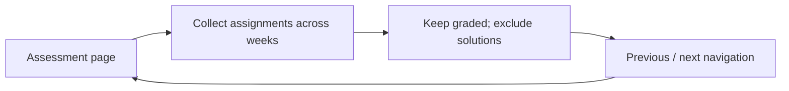

# Features

This page summarizes behavior present in the current extension. The [architecture](ARCHITECTURE.md), [programming assignments](PROGRAMMING_ASSIGNMENTS.md), and [answer protocol](ANSWER_PROTOCOL.md) guides describe the corresponding implementation boundaries.

## Assessment Reader

- Detects supported IITM assessment pages and traverses their question navigation.
- Extracts question content into a canonical document model and presents it in the extension Reader.
- Renders supported mathematical and rich content and provides question navigation, zoom, and image viewing controls.

## Answer review and AI-assisted workflow

- Builds a prompt from the assessment document for the student to copy to an external AI service.
- Accepts indexed answer records such as `1: A` and `2: B,C`; validates suggestions against the current assessment.
- Shows answer review state and applies confirmed choices to the active portal form only after a student action.
- Does not automatically submit the assessment.

## Programming assignments

- Separates the programming assignment information page from the active coding page.
- Extracts problem information and available test cases from an active programming assignment.
- Embeds CodeMirror in the Reader as a local editable working buffer. IITM’s existing Ace editor remains authoritative.
- Supports the languages listed in `src/bridge/languages.js` and includes highlighting, completion, indentation, clipboard editing, and undo/redo.
- Applies changes through the privileged write path, restricted to the editable region and checked against the captured editor/question context and scaffold.
- Imports plain code or multiple fenced blocks through a shared parser, merges uniquely matched function or method definitions, and leaves the buffer unchanged when a partial or ambiguous merge cannot be done safely.

## Export

- Produces Markdown and PDF/print output from the canonical document model.
- Can package assessment-linked resources into a portable bundle.
- Uses local extension-bundled libraries for document/PDF generation; resource fetching for exports is described in [Security](SECURITY.md).

## Academic events and notifications

- Retrieves only course-independent weekly assignment deadlines (`course_code IS NULL`) from the configured Supabase `public.academic_events` endpoint.
- Caches those weekly deadlines in extension storage and schedules deadline-related browser notifications.
- Does not infer submission status from IITM page content.

## Course grades and grading policies

- Shows a floating grade-calculator button on course and Grades pages; it does not open a dialog automatically.
- Looks up the course policy by term and course code from `public.course_grading_policies`. Students can search for another course from inside the calculator.
- Calculates the weighted score, each assessment's contribution, and remaining marks needed to reach the policy pass mark. The calculator requires an explicit **Calculate** action.
- Reads graded assignment results from the Grades page and stores those student scores locally. Scores are not uploaded to Supabase; other assessment marks can be entered manually.
- Policy-table setup and the grading-policy JSON format are maintained in `supabase/migrations/` and `src/portal-decor/grade-calculator.js`.

## Course page helpers

- Filters expired items from the popup's upcoming-deadline list and emphasizes the nearest future deadline with a live countdown.
- Replaces IITM's image-only lecture-slide button with a compact, keyboard-accessible download link while keeping its original destination.
- Adds **Summarise** next to the video transcript. It copies a prompt containing every visible timestamped transcript cue and the active YouTube URL when the player exposes one; the prompt is sent to no AI service by Acadrix.

## Course outline navigation

- On a graded assignment, adds **Previous** and **Next** buttons above the assignment view; unavailable directions are disabled.
- Uses the course-outline order and opens the selected item through IITM’s existing course-outline control. Practice work and course content are not navigation targets.
- The controls use IITM’s secondary-button styling and do not appear on non-graded items.
- See the [graded assignment navigation source](diagrams/graded-navigation.mmd) or the [interactive navigation view](diagrams/graded-assignment-navigation.html) for the interaction flow.

## Browser extension surfaces

The Manifest V3 extension includes a popup, content scripts, and a background service worker. The repository also builds a lightweight bookmarklet target; it does not have the extension background capabilities used for privileged programming writes and notification scheduling.
